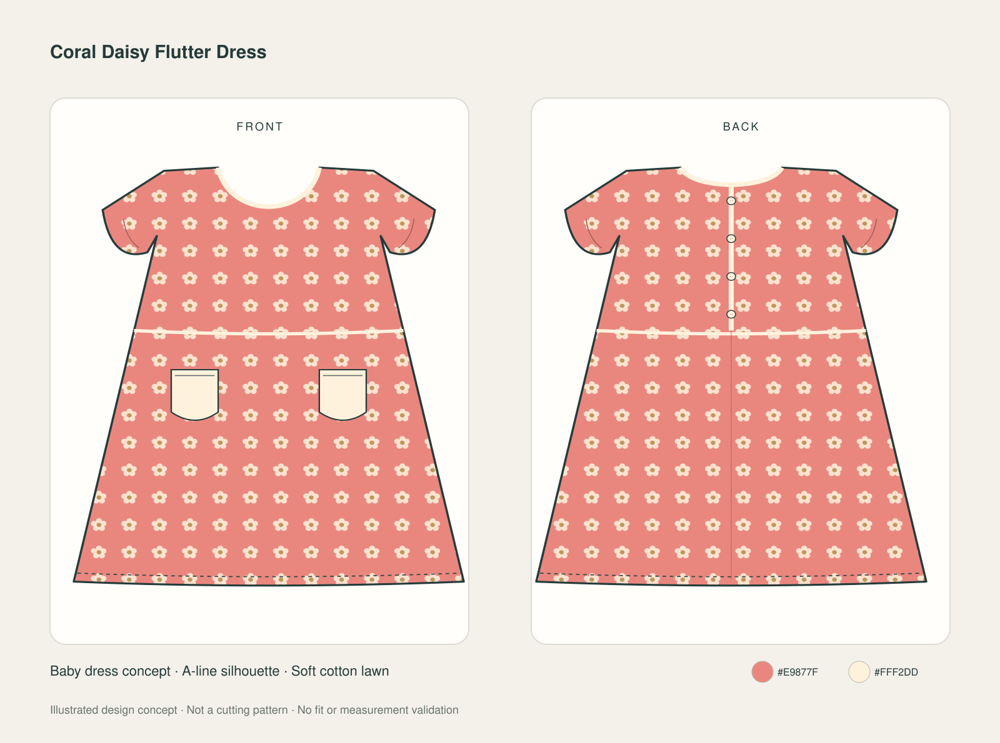

# Fashion Design Studio

An open-source AI skill for creating and revising garment design concepts in
compatible ChatGPT/Codex and Claude environments.

Describe a women's top, baby dress or another garment, or supply a reference
image. The skill guides the assistant to produce a coherent concept with matching
front/back views, colourways and a short design brief.

**This is a reusable skill, not a hosted web application.** Installing it does
not add an image model or grant access to external services.



The example is an illustrated SVG fashion concept. It is not a photograph or a
cutting pattern. [Editable SVG](examples/coral-daisy-dress.svg) ·
[Design brief](examples/design-brief.md)

## Download

Open [the installable skill ZIP](downloads/fashion-design-studio.zip), then use
GitHub's download button. The ZIP contains one top-level `fashion-design-studio/`
folder with `SKILL.md` and its supporting files.

Use this ZIP for skill upload. The repository's **Code > Download ZIP** archive
also contains examples and project documentation and has a different layout.

## What the skill does

- Interprets text, sketches and reference photos as a design brief.
- Creates matching front/back garment views and optional requested details.
- Revises neckline, sleeves, pockets, closures, colours and fabric appearance.
- Uses an available image tool for realistic previews, or produces editable SVG
  fashion flats when vector output is requested or image generation is absent.
- Preserves accepted designs during bounded revisions and flags missing visuals.

It creates design concepts only. It does not draft cutting patterns, derive fit,
grade sizes, write sewing tutorials, or validate physical sewing/printing results.

## ChatGPT and Codex

Use a ChatGPT/Codex surface that supports standalone skills and follow its skill
upload or installer workflow. Availability depends on the product, account and
workspace. Where a **Skills > Create > Upload** option is present, upload the
skill ZIP and finish that interface's installation flow. In Codex, a compatible
skill installer can also install the `fashion-design-studio/` folder from this
repository; repository-scoped setups use the documented skills directory.

After installation, select **Fashion Design Studio** in the skill picker, or
mention the skill explicitly in a design request. Do not assume attaching the
ZIP to an ordinary chat permanently installs it.

Image previews depend on an image-generation tool actually available in the
session. The SVG route needs code execution or SVG-artifact support. For wider
ChatGPT distribution, OpenAI currently recommends packaging skills as plugins;
this project supplies a standalone skill.

[Official OpenAI skill documentation](https://learn.chatgpt.com/docs/build-skills)

## Claude

1. Enable **Code execution and file creation** if required by your account.
2. Open **Customize > Skills**.
3. Select the add/create option, then **Upload a skill**.
4. Upload `downloads/fashion-design-studio.zip` and enable the skill.
5. Ask for a garment design, mentioning **Fashion Design Studio** if needed.

Account and organization controls can affect these options. Claude does not
natively generate photographs like an image generator; use this skill's editable
SVG fashion flats unless an appropriate image tool is separately available.

[Official Claude skills guide](https://support.claude.com/en/articles/12512180-use-skills-in-claude)
· [Custom skill packaging](https://support.claude.com/en/articles/12512198-how-to-create-custom-skills)
· [Claude image capabilities](https://support.claude.com/en/articles/9002504-can-claude-produce-images)

## Example requests

> Use Fashion Design Studio to create a simple sage women's top with a square
> neckline and short sleeves. Show matching front and back views.

> Ek simple coral baby dress design banao, flutter sleeves aur do front pockets
> ke saath. Front aur back dono views do, editable SVG mein.

> Keep this design and colour. Change only the neckline to a V-neck and update
> the matching back view where necessary.

## Reproduce the basic SVG workflow

With Python 3.10 or newer, run from the repository root:

```sh
python3 fashion-design-studio/scripts/render_flats.py \
  --input fashion-design-studio/references/design-brief.json \
  --output design-front-back.svg
```

The renderer uses only Python's standard library, makes no network requests and
requires no API key. See [SVG options](fashion-design-studio/references/svg-options.md)
for supported top, dress and skirt template options. Other concepts can use
custom SVG work or an available image tool. The example dress includes manual
vector refinements recorded in its brief; the JSON recreates its template base.

## Validation and status

Initial local checks covered eight renderer variations, five rejected unsupported
inputs, command-line output, SVG structure and visual inspection of sample sheets.
An independent design task also produced an inspected baby-dress concept.

The skill was installed and verified in its author's ChatGPT skills environment.
Live installation in Claude and photographic-generation behavior have not been
verified. This is an early-stage project; public usage has not been established.
Platform notes were checked on 2026-11-01 and interface labels can change.

## Rebuild the installable ZIP

```sh
python3 tools/package_skill.py
```

The output is `downloads/fashion-design-studio.zip`. The packaging script retains
the declared portable skill files and excludes local caches and example outputs.

## License

[MIT](LICENSE). The skill package includes its own copy of the license.
